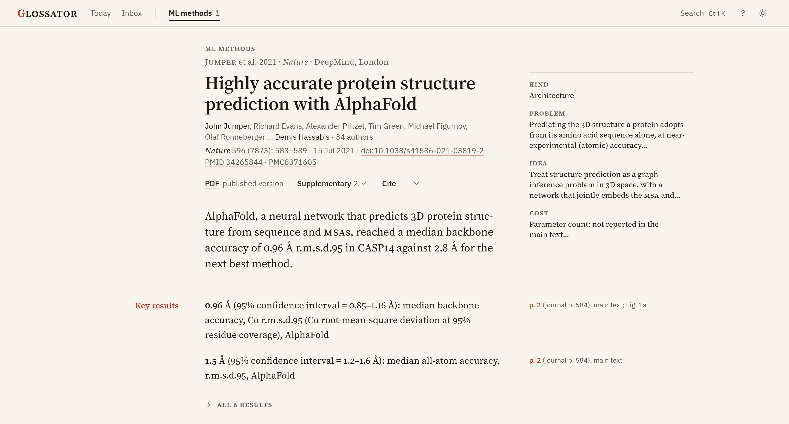
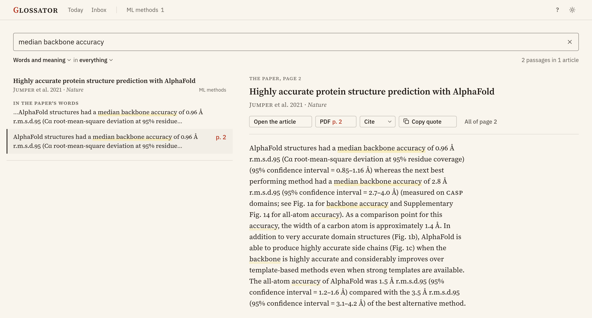
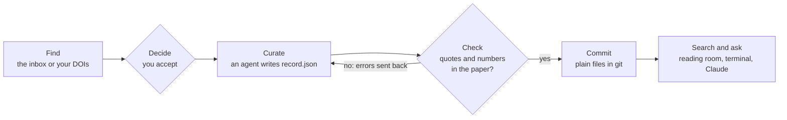

<h1 align="center">Glossator</h1>

<p align="center">
  <strong>Papers read by Claude, checked by code, kept in git.</strong>
</p>

<p align="center">
  <a href="#1-try-the-demo">Try the demo</a> ·
  <a href="docs/README.md">Documentation</a> ·
  <a href="docs/how-it-works.md">How it works</a> ·
  <a href="CHANGELOG.md">Changelog</a>
</p>

<p align="center">
  <a href="https://github.com/camilziane/glossator/actions/workflows/ci.yml"></a>
  <a href="LICENSE"></a>
  
  
</p>

<picture>
  <source media="(prefers-color-scheme: dark)" srcset="docs/images/hero-dark.png">
  
</picture>

Glossator is for researchers who build a literature review and want every claim traced to its page.

A Claude agent reads each open-access paper and writes its record, a structured summary where every fact gives its
page. Code then proves that each quote and each reported number in the record is in the paper.

- **Sent back until it passes.** A record that fails `check` returns to its agent with the errors, at most twice.
- **Plain files in git.** One folder per article: the PDF, `record.json` and the figures. You review changes like code.
- **Search with pages.** Keyword and semantic search over records and full text, run on your computer. Claude
  searches it too, through an MCP server.
- **A daily inbox.** New papers from OpenAlex, PubMed, arXiv, bioRxiv and medRxiv, ranked for your bibliographies.
  Nothing enters without your approval.
- **Zotero, if you use it.** Your articles and their summaries appear in Zotero. Your own tags and notes stay yours.

> [!NOTE]
> Glossator is alpha software (version 0.1) with one maintainer. It runs on Linux and on macOS with Apple silicon.

## 1. Try the demo

You need git, [uv](https://docs.astral.sh/uv/getting-started/installation/) and poppler (`brew install poppler` on
macOS, `sudo apt install poppler-utils` on Debian or Ubuntu). The demo needs no Claude account.

```sh
git clone https://github.com/camilziane/glossator
cd glossator
uv sync
uv run glossator demo
```

`uv sync` takes about 1.3 GB on Linux. `glossator demo` downloads the search model once, builds the demo's index and
opens the reading room, Glossator's web app, at <http://127.0.0.1:8765/>. Without Node.js 20.19 or later, it shows
a simpler page.



## 2. Search and verify

The demo holds one article with its record, AlphaFold (Nature, 2021). Stop the reading room with `Ctrl+C`. Then
search the demo, verify a quote on its page, and check every record. `--home demo` points a command at the demo
library instead of your own:

```sh
uv run glossator --home demo search "median backbone accuracy"
uv run glossator --home demo verify jumper2021 "median backbone accuracy of 0.96" --page 2
uv run glossator --home demo check --all
```

`verify` answers `verbatim on p. 2`. `check` ends with what it proved:

```console
methods: 1 article, no errors. Found in the papers' text: 3 quotes, 15 numbers.
```

With [Claude Code](https://claude.com/claude-code), start it on the demo with `GLOSSATOR_HOME=demo claude` and ask
"How accurate is AlphaFold in CASP14? Cite the pages." Claude answers from the demo, with the article and the page.

## 3. How it works



| Part | What it does | Where it runs |
|---|---|---|
| `glossator` | Fetches open PDFs, checks records, builds the search index, serves the reading room | Your computer |
| Curator agent | Reads one paper and writes its record until `check` passes | Claude Code (Sonnet) |
| Scout agent | Rates the inbox's new papers against your bibliographies | Claude Code (Haiku) |
| Librarian agent | Answers questions from the search index, with article and page | Claude Code (Sonnet) |
| You | Pick papers, read records, commit | Reading room, terminal, Claude or Zotero |

What `check` proves, and what it does not: [How it works](docs/how-it-works.md#what-check-proves).

## 4. Start your own library

To curate papers, you also need [Claude Code](https://claude.com/claude-code), signed in.

1. Create your library and its first bibliography, a reading list in its own folder. Call the folder `methods`.
   ```sh
   uv run glossator init
   ```
2. Curate a paper by its DOI, here the NumPy paper (Nature, 2020). `--dry-run` shows what the agent will be asked
   and spends nothing.
   ```sh
   uv run glossator curate 10.1038/s41586-020-2649-2 --bib methods --dry-run
   uv run glossator curate 10.1038/s41586-020-2649-2 --bib methods
   ```
3. Build the index and the reading room, then open it. `web` needs Node.js, once per computer.
   ```sh
   uv run glossator build
   uv run glossator web
   uv run glossator serve --open
   ```

The [getting-started tutorial](docs/getting-started.md) explains each step. Without a Claude account, you can
[add papers by hand](docs/guides/add-papers.md#without-claude).

## 5. Everyday use

`glossator` stands for `uv run glossator`, run from the repository folder.

| Task | Command |
|---|---|
| [Get new papers every day](docs/guides/inbox.md) | `glossator inbox init`, then `glossator inbox start` |
| [See the papers in the inbox](docs/guides/inbox.md#accept-or-reject-papers) | `glossator inbox list` |
| Accept or reject a paper | `glossator inbox accept <id>` or `glossator inbox reject <id>` |
| [Curate the papers you accepted](docs/guides/add-papers.md) | `glossator curate --inbox` |
| Search the library | `glossator search "<question>"` |
| Check a quote before citing it | `glossator verify <key> "<text>" --page <n>` |
| [Check every record](docs/how-it-works.md#what-check-proves) | `glossator check --all` |
| Look for retractions and corrections | `glossator notices` |
| Update the index after changes | `glossator build` |
| [Sync with Zotero](docs/guides/zotero.md) | `glossator zotero setup`, then `glossator zotero sync` |
| [Work on several computers](docs/guides/computers.md) | `glossator join <address>`, then `glossator sync` |
| [Add a bibliography](docs/guides/bibliographies.md) | `glossator bibs add` |
| [Ask Claude about your papers](docs/guides/ask-claude.md) | `claude`, in the repository folder |
| [Find what is wrong](docs/troubleshooting.md) | `glossator doctor` |

Every command and option: [CLI reference](docs/reference/cli.md).

## 6. Cost, safety and privacy

- **Cost.** Curating a paper costs about half a dollar on Claude Sonnet in our runs, more for a long paper. With
  the default limits, one article costs at most $15: see [cost](docs/guides/add-papers.md#cost).
- **Safety.** Curators run unattended and read PDFs from the internet. Before you curate, read
  [how Glossator contains them](SECURITY.md#the-curator-agents).
- **Privacy.** Glossator has no telemetry. What the agents read goes to Anthropic through Claude Code, and DOIs and
  inbox queries go to public scholarly APIs. [Privacy](docs/privacy.md) lists every outbound request.

## 7. Requirements

| Requirement | Needed for |
|---|---|
| Linux, or macOS with Apple silicon | Everything. Windows is not supported yet. |
| [uv](https://docs.astral.sh/uv/) | Everything. It installs Python 3.11 or later and the dependencies. |
| poppler-utils | Reading PDFs: `pdfinfo`, `pdftotext`, `pdftoppm` |
| [Claude Code](https://claude.com/claude-code), signed in | Curation, inbox triage and questions. Not the demo, search or `check`. |
| Node.js 20.19 or later | Optional. Builds the reading room, once per computer. |
| Git LFS 3.0 or later | Optional. Keeps PDFs out of git's history, for several computers. |
| A Zotero account | Optional. Zotero sync. |
| An NVIDIA GPU, driver 525 or later | Optional. Faster first builds of a large library: see the [CUDA install](docs/getting-started.md#1-install-glossator). |

## 8. Limits

- Open-access PDFs only. A paper behind a paywall waits for a PDF you add yourself.
- `check` proves that each quote is in the article's PDFs and each reported number is printed in the paper. It does
  not prove a quote's page (`verify` does) or the record's interpretation: read the records you rely on.
- The search model is English. A scanned PDF without a text layer is searched through its record only.

## 9. Related projects

| Project | Best for |
|---|---|
| [paper-qa](https://github.com/Future-House/paper-qa) | Questions over a folder of PDFs, with citations |
| [zotero-mcp](https://github.com/54yyyu/zotero-mcp) | Giving Claude access to an existing Zotero library |
| [zotero-arxiv-daily](https://github.com/TideDra/zotero-arxiv-daily) | Daily arXiv recommendations from a Zotero library |
| [papis](https://github.com/papis/papis) | A command-line bibliography manager on plain files |

Glossator differs in its records: structured notes whose quotes and numbers code proves are in the paper.

## 10. Documentation

Start with [Getting started](docs/getting-started.md) and [How it works](docs/how-it-works.md). The
[documentation index](docs/README.md) lists every guide and reference page. When something goes wrong, run
`uv run glossator doctor`, then read [Troubleshooting](docs/troubleshooting.md).

## 11. Contributing and license

Bug reports and pull requests are welcome: read [CONTRIBUTING.md](CONTRIBUTING.md). Report security issues
privately, as [SECURITY.md](SECURITY.md) explains.

Glossator is released under the [MIT license](LICENSE). The demo paper is its publisher's open-access version,
under its Creative Commons license ([demo/README.md](demo/README.md)).
