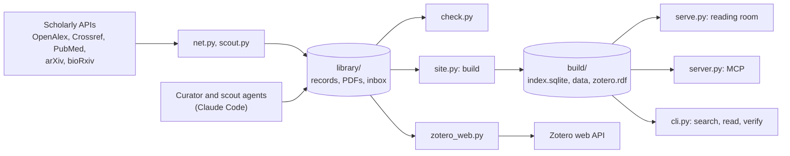

# Architecture

Glossator is a Python package, `src/glossator/`, with one command, `glossator`. A Next.js app in `web/` is the
reading room. Claude Code agents in `.claude/` do the reading. This page maps the code for contributors.

## Data flow

## Modules

| Module | Holds |
|---|---|
| `cli.py` | The command line: every subcommand and its options |
| `profiles/` | The profile interface, the built-in `ml` and `epidemio` profiles, and the loader of a library's plugins. See [profile plugins](../reference/profile-plugins.md). |
| `bibliography.py` | `Bibliography` and `Collection`, and which bibliography a command works on |
| `records.py` | The record shape, the skeleton `new` writes, and the vocabularies |
| `commands.py` | The commands that make an article's folder: `new`, `fetch-pdf`, `supp`, `text`, `page`, `crop`, `cite`, `vocab`, `list` |
| `check.py` | What `check` enforces |
| `net.py` | Metadata from Crossref, OpenAlex and DataCite, and open copies of papers |
| `pdf.py` | Page counts, text and page renders, through poppler |
| `render.py` | An article's view and a bibliography's tables, in HTML or Markdown |
| `site.py` | `build`: the reading room's data, the static page, the index, the Zotero file and the manifest |
| `sitedata.py` | The reading room's data, `build/data/library.json` |
| `index.py` | The search index and the hybrid search |
| `vectors.py` | The embedding model: builds on GPU or CPU, queries on CPU through ONNX Runtime |
| `serve.py` | `glossator serve`: the reading room, the data, the files and the search API on 127.0.0.1 |
| `server.py` | `glossator mcp`: the MCP server |
| `inbox.py` | The daily inbox: `watch.toml`, runs, decisions, the crontab line |
| `scout.py` | The inbox's sources |
| `triage.py` | The triage by the scout agent on Claude Haiku |
| `prior.py` | A new paper's closeness to each bibliography, computed locally |
| `curate.py` | `glossator curate`: headless curator runs, resumed until `check` passes |
| `notices.py` | Retractions and corrections, from Crossref |
| `zotero.py` | The Zotero RDF file |
| `zotero_web.py` | Sync with Zotero's web API |
| `sync.py` | `glossator sync`: git pull and push of the library |
| `settings.py` | `library.toml` |
| `paths.py`, `util.py` | Where things are, and small helpers |

The setup commands have modules of their own:

| Module | Holds |
|---|---|
| `ask.py` | Questions, plans and progress lines, shared by every setup command, with their flags for scripts |
| `start.py` | `init` and `bibs add` |
| `join.py` | `join` |
| `original.py` | `promote` and `follow` |
| `zotero_setup.py` | `zotero setup` |
| `doctor.py` | `doctor` |
| `webapp.py` | `web` and `demo` |
| `remote.py`, `repo.py` | Another computer's library over ssh, and the library's git repository |

## Rules the code keeps

- Records are the only hand-written files. Everything in `build/` is generated and never committed.
- Each computer builds its own `build/`. `sync` moves git commits and nothing else.
- Glossator never commits articles. It commits `library/inbox/` after each inbox run and decision, and the
  setup commands (`init`, `bibs add`, `promote`) commit what they write.
- A change keeps every article's view and Markdown export unchanged, unless that is its point.
- The demo passes `uv run glossator --home demo check --all`.

How to set up, test and propose a change: [CONTRIBUTING.md](../../CONTRIBUTING.md).
