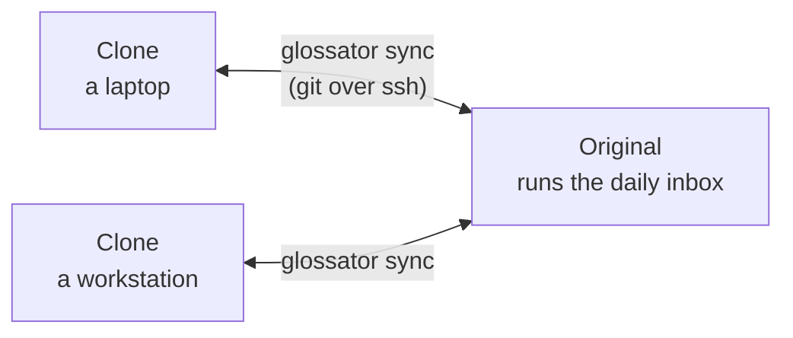

# Several computers

Your library is a git repository, so every computer can hold all of it: records, PDFs and the inbox. Computers
exchange git commits and nothing else. Each one builds its own search index.



| Computer | Holds | Runs |
|---|---|---|
| The original | The whole library | The daily inbox, and everything else |
| A clone | The whole library, or its records only | Everything but the daily inbox |

Any computer can add papers, accept or reject inbox papers, and build. `glossator sync` carries the commits both ways.

| Task | Command | Run on |
|---|---|---|
| Get the command to join | `glossator doctor` | The original |
| Join a library | `glossator join <address>` | The new computer |
| Exchange commits | `glossator sync` | A clone |
| Make this computer the original | `glossator promote` | The future original |
| Follow a new original | `glossator follow <address>` | Each other clone |

## Before you start

- The new computer reaches the original over ssh with a key: `ssh <host>` works without a password.
- If the library keeps its PDFs in Git LFS, both computers have Git LFS 3.0 or later, and the original has
  `git-lfs-transfer`.
- Glossator is installed on the new computer: see [Getting started](../getting-started.md#1-install-glossator).

## Join from another computer

1. On the original, run `uv run glossator doctor`. It prints the command the others join with, such as
   `glossator join you@lab.example.org:/srv/glossator/library`. It guesses the computer's name, so check that the
   new computer reaches it under that name, for example behind a router or a VPN.
2. On the new computer, in the repository folder, run that command with `uv run`:

   ```sh
   uv run glossator join you@lab.example.org:/srv/glossator/library
   ```

`glossator join` checks ssh and Git LFS on both computers and shows its plan. It then clones the library, records
first and files after, and turns on Git LFS. It builds this computer's search index, and the reading room when
Node.js is installed.

If `join` stops halfway, run it again: it continues where it stopped.

An address is `[user@]host:path`, `ssh://host/path`, or a local path such as a shared disk. The path is the
original's `library/` folder. If you give the repository folder that holds it, `join` finds `library/` inside.

## Sync

```sh
uv run glossator sync
```

`glossator sync` pulls the original's commits, then pushes yours, replayed on top. If they conflict, it stops and
changes nothing.

- Sync before you add papers, and after you commit them.
- `sync` never builds. Run `uv run glossator build` to get the new articles in your index.
- On the original, `sync` has nothing to do: the others sync with it.

## Make another computer the original

Use this when the original retires, or when another computer should run the daily inbox.

1. On the future original, commit your changes and run `uv run glossator sync`.
2. On the future original, run:
   ```sh
   uv run glossator promote
   ```
3. On each other clone, run `uv run glossator sync`. It stops and prints the command that points the clone at the
   new original. It keeps stopping until you run that command.
4. Run that command, such as:
   ```sh
   uv run glossator follow lab2.example.org:/srv/glossator/library
   ```

`promote` checks that both computers hold the same commits, with nothing uncommitted. It asks how the other
computers reach this one, and at what time the daily inbox should run here. Over ssh, it stops the daily run on the
old original and turns it into a clone of this computer.

If the old original is gone for good, run `uv run glossator promote --old-gone`. Commits that only it held are lost.

Check it worked: `uv run glossator inbox status` on the new original shows the daily schedule.

## Clones without the PDFs

A light clone skips the PDFs and keeps Git LFS's small pointer files instead:

```sh
uv run glossator join --light you@lab.example.org:/srv/glossator/library
```

The clone remembers it is light: later syncs do not download the PDFs either. On a light clone, `check` compares
each missing file's checksum and reports it as "not downloaded here", without an error. Search covers the records
only until you download the files. To make a light clone full (every file downloaded, now and at each sync):

```sh
uv run glossator join --full
```

A light clone, or a computer without Git LFS, still syncs records and inbox decisions both ways. Only a commit that
adds PDFs needs Git LFS on the computer that pushes it.

## Next

- [The daily inbox](inbox.md)
- [Troubleshooting](../troubleshooting.md#several-computers)
- [CLI reference](../reference/cli.md#join)
