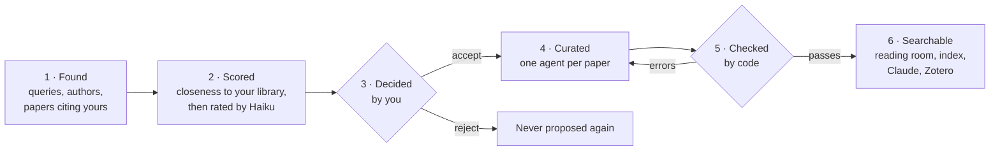

# How it works

Glossator turns papers into records you can check. This page explains the parts, the life of a paper, and what
the checks prove.

## The parts

| Part | What it is | Where it runs |
|---|---|---|
| `glossator` | The command line. It fetches open PDFs, checks records, builds the search index and serves the reading room. | Your computer, no service |
| The library | Your bibliographies: a git repository of plain files, in `library/` | Every computer you use |
| `build/` | The search index, the reading room's data and a Zotero file, written by `glossator build` | Each computer builds its own |
| The reading room | A web app at <http://127.0.0.1:8765/>, served by `glossator serve` | Your browser, offline |
| The MCP server | `glossator mcp`: the search index, for Claude and other MCP clients | Your computer |
| Curator agent | Reads one paper and writes its record | Claude Code, Sonnet |
| Scout agent | Rates the inbox's new papers | Claude Code, Haiku |
| Librarian agent | Answers questions from the search index | Claude Code, Sonnet |

The agents are Claude Code agents, defined in `.claude/agents/`. Everything else runs on your computer: the
command in Python, and the reading room as a static web app.

## The life of a paper



1. **Found.** Each day the inbox asks OpenAlex, PubMed, arXiv, bioRxiv and medRxiv for new papers. It uses your
   queries and watched authors. It also asks OpenAlex for recent papers that cite your articles.
2. **Scored.** Each new paper gets a closeness score to each bibliography, computed on your computer: first its
   similarity to the papers you kept, then, once you have decided enough, a small model of your decisions (see
   [How papers are ranked](guides/inbox.md#how-papers-are-ranked)). Claude Haiku then rates it from 0 to 3 against
   each bibliography's scope.
3. **Decided.** You accept or reject each paper: in the reading room, in the terminal, in Claude or in Zotero.
   You can also skip the inbox and name papers by DOI.
4. **Curated.** One curator agent per paper reads the full text and writes `record.json`. Every fact gets its page.
   The key sentences are copied word for word.
5. **Checked.** `glossator check` tests the record. An article that fails goes back to its agent with the errors,
   at most twice.
6. **Searchable.** `glossator build` indexes the records and the full text. You search in the reading room or the
   terminal, and Claude searches through the MCP server.

Papers enter your library only when you accept them or name them.

## What `check` proves

`glossator check` tests every article. An error fails the article, and a curator gets it back. A warning asks a
person to look.

| Rule | If it fails |
|---|---|
| Each quote is in the article's PDFs: the paper or its supplementary files | Error |
| Each number of a reported result is printed in the paper. A value read off a figure starts with `≈`. | Error |
| The folder holds exactly `paper.pdf`, `record.json`, `figures/` and `supplementary/` | Error |
| The record has every field of its profile and no other, with no empty value and no TODO | Error |
| Controlled fields use a value from the profile's vocabulary | Error |
| `paper.pdf` matches the checksum and page count in the record | Error |
| When a result's source cites a page, its numbers are on that page or beside it | Warning |
| An estimate with its confidence interval appears with its bounds, in that order | Warning |

`glossator check --all` also looks for stray folders in each bibliography. On the demo, it reports:

```console
jumper2021: no errors, no warnings. Found in the paper's text: 3 quotes, 15 numbers.
methods: 1 article, no errors. Found in the papers' text: 3 quotes, 15 numbers.
```

## What `check` does not prove

- **A quote's page.** `check` finds a quote anywhere in the PDFs. `glossator verify` tests a quote on a given page,
  and answers, for example, `verbatim on p. 2`.
- **A result's interpretation.** Summaries and explanations are the agent's words. Read the records you rely on.
- **That the paper is right.** `glossator notices` asks Crossref for retractions and corrections. The daily inbox
  asks once a week.

## The search index

`glossator build` writes `build/index.sqlite`. It holds two kinds of passages:

- **Record passages.** One per section or list item of each record, such as `record:results[2]`.
- **Text passages.** Each PDF's text, page by page, cut into passages of about a paragraph, such as
  `paper.pdf#5.2` (page 5, passage 2).

A search ranks passages two ways, by words (SQLite FTS5 and BM25) and by meaning (a small embedding model), then
fuses both rankings. Exact terms and paraphrases both find their passages. Use `--mode keyword` or
`--mode semantic` for one ranking only.

The embedding model is `BAAI/bge-small-en-v1.5`, run on your computer. A build reads and embeds only what is new, so
later builds take seconds. A search takes about a second, on the CPU.

| First build, on a CPU | Time |
|---|---|
| The demo: one article, 320 passages | About 35 seconds, model loading included |
| A library of 10,000 passages | About 8 to 9 minutes on a workstation, 10 to 20 on a laptop |

A GPU makes the first build of a large library much faster. See
[Getting started](getting-started.md#1-install-glossator) for the CUDA install.

## Where files live

```text
glossator/            this repository: the tool
├── library/          your bibliographies: a git repository of its own
│   ├── library.toml  the library's settings
│   ├── <bibliography>/
│   └── inbox/        the daily inbox
└── build/            written by `glossator build`, never committed
```

Every folder and file: [files and folders](reference/files.md).

## Several computers

The library is a git repository, so every computer can hold all of it. One computer, the original, runs the daily
inbox. The others clone it, exchange commits with `glossator sync` and build their own index: see
[several computers](guides/computers.md).

## Glossary

| Term | Meaning |
|---|---|
| Library | All your bibliographies, in one git repository |
| Bibliography | One reading list in the library, with its own profile and scope |
| Scope | One or two sentences, in `biblio.json`, on what belongs in a bibliography |
| Profile | The shape of a bibliography's records: their sections and vocabularies |
| Paper | A publication. In the inbox, a candidate not curated yet. |
| Article | A paper once curated: a folder in a bibliography |
| Record | An article's `record.json` |
| Inbox | The daily list of new papers waiting for your decision |
| Triage | The scout's rating of each new paper against the scopes, from 0 to 3 |
| Curator, scout, librarian | The Claude Code agents that write records, rate inbox papers and answer questions |
| Reading room | The web app that `glossator serve` shows |
| Original | The computer the others clone from. It runs the daily inbox. |
| Clone | Any other computer with the library |

## Next

- [Getting started](getting-started.md)
- [Add papers](guides/add-papers.md)
- [Record format](reference/record-format.md)
